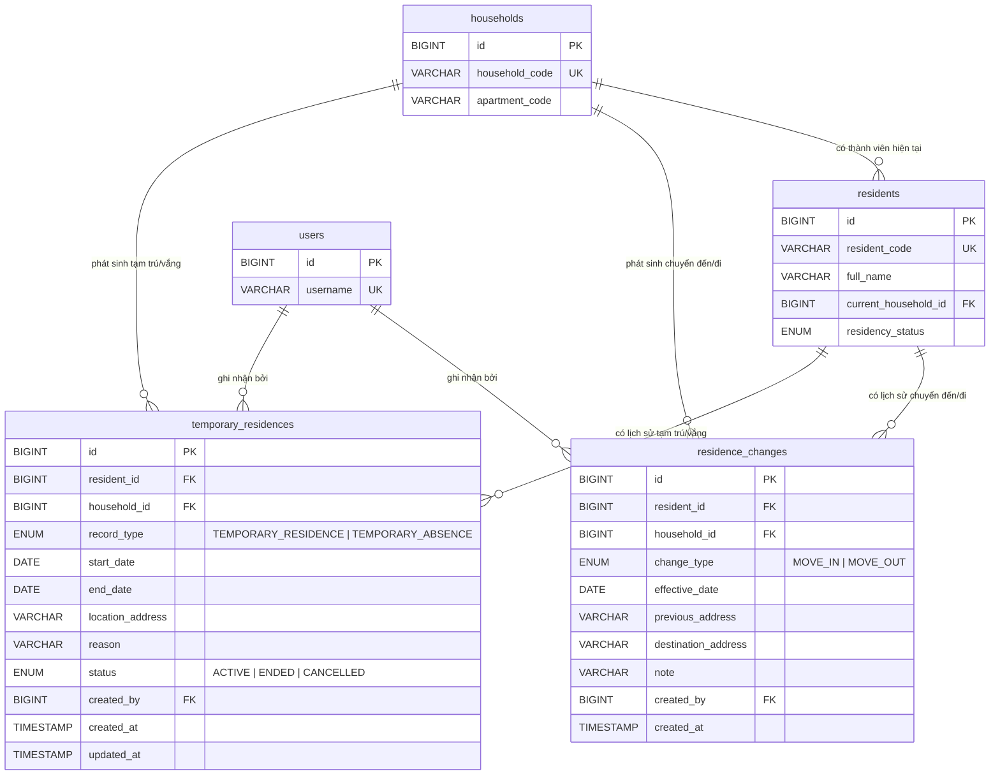

# Thiết kế dữ liệu và nghiệp vụ Biến động cư trú — BlueMoon (Tuần 1)

- **Người thực hiện:** Nguyễn Trần Tuấn Kiệt (MSSV: 202416257)
- **Phối hợp:** Đỗ Duy Hưng (Thiết kế hộ–cư dân & tổng hợp ERD chung), Nguyễn Quang Huy (Thiết kế API tra cứu `api-search.md`).
- **Tài liệu căn cứ:** US-06, US-07, US-15 và Acceptance Criteria tương ứng; NFR-002, NFR-005, NFR-007; [api-search.md](../../../docs-api/docs/design/api-search.md) (mục 7 — Lịch sử biến động cư trú); [auth_audit.sql](../../../backend-auth-skeleton/database/auth_audit.sql) (quy ước kiểu dữ liệu MySQL).
- **Trạng thái:** Bản thiết kế đề xuất gửi Đỗ Duy Hưng tổng hợp vào ERD chung. Các khóa ngoại tham chiếu `households(id)` và `residents(id)` sẽ được kích hoạt đồng bộ sau khi bảng `households` và `residents` được chốt tên bảng và cột.

---

## 1. Phân tích yêu cầu nghiệp vụ

### 1.1. Chuyển đến và Chuyển đi (US-06)
- **Chuyển đến (`MOVE_IN`):** Ghi nhận cư dân bắt đầu cư trú tại một hộ gia đình kể từ `effective_date`.
  - Cập nhật hộ hiện tại của cư dân thành `household_id` và trạng thái cư trú thành `RESIDING` (đang cư trú).
  - Nếu cư dân chuyển từ hộ A sang hộ B trong cùng chung cư: ghi nhận `MOVE_OUT` ở hộ A và `MOVE_IN` ở hộ B (hoặc ghi rõ `previous_household_id`), bảo toàn lịch sử tại hộ A.
- **Chuyển đi (`MOVE_OUT`):** Ghi nhận cư dân rời khỏi hộ gia đình kể từ `effective_date`.
  - Cập nhật trạng thái cư trú của cư dân thành `MOVED_OUT` (đã chuyển đi).
  - **Không xóa hồ sơ cư dân** và **không xóa lịch sử tại hộ cũ** để đảm bảo tra cứu lịch sử theo hộ vẫn hiển thị cư dân từng cư trú (theo `api-search.md` mục 7.6).

### 1.2. Tạm trú và Tạm vắng (US-07)
- **Tạm trú (`TEMPORARY_RESIDENCE`):** Ghi nhận người đến tạm trú tại một hộ trong khoảng `[start_date, end_date]` (`end_date` có thể `NULL` nếu chưa xác định ngày kết thúc).
- **Tạm vắng (`TEMPORARY_ABSENCE`):** Ghi nhận cư dân của hộ tạm vắng khỏi căn hộ trong khoảng `[start_date, end_date]` (`end_date` có thể `NULL`).
- **Ràng buộc thời gian bắt buộc:**
  - `start_date` không được `NULL`.
  - Nếu `end_date IS NOT NULL`, bắt buộc `end_date >= start_date`.
  - Khi lọc theo khoảng `[fromDate, toDate]` ở US-15: sự kiện có khoảng thời gian khớp nếu `start_date <= toDate` và `(end_date IS NULL OR end_date >= fromDate)`.

### 1.3. Phân biệt Lịch sử cư trú và Nhật ký hệ thống (`audit_logs`)
- **Lịch sử cư trú (`residence_changes`, `temporary_residences`):** Lưu dữ liệu nghiệp vụ gắn với `effective_date` / `[start_date, end_date]`, phục vụ tra cứu lịch sử cư trú theo hộ hoặc cư dân (US-15).
- **Nhật ký hệ thống (`audit_logs`):** Lưu thao tác kỹ thuật của người dùng (`actor_user_id`, `action`, `created_at`) theo NFR-005 khi thêm/sửa biến động cư trú.

---

## 2. Sơ đồ quan hệ dữ liệu (ERD cục bộ)



> **Lý do tách 2 bảng `residence_changes` và `temporary_residences`:**
> - Chuyển đến/đi (US-06) là sự kiện **tại một thời điểm** (`effective_date`), tác động trực tiếp đến hộ hiện tại của cư dân.
> - Tạm trú/tạm vắng (US-07) là đăng ký **theo khoảng thời gian** (`start_date`..`end_date`), có trạng thái hiệu lực và địa chỉ/lý do riêng.
> - Cả 2 bảng dùng chung mã loại sự kiện (`MOVE_IN`, `MOVE_OUT`, `TEMPORARY_RESIDENCE`, `TEMPORARY_ABSENCE`) và có thể gộp qua view `v_residence_history` để phục vụ API tra cứu hợp nhất của US-15 (`api-search.md` mục 7.8 đã xác nhận DTO không bắt buộc gộp chung 1 bảng vật lý).

---

## 3. Mô tả chi tiết bảng và ràng buộc

### 3.1. Bảng `residence_changes` (US-06: Chuyển đến / Chuyển đi)

| Cột | Kiểu dữ liệu | Bắt buộc | Ràng buộc / Ý nghĩa |
|---|---|---|---|
| `id` | `BIGINT AUTO_INCREMENT` | Có | Khóa chính (PK). |
| `resident_id` | `BIGINT` | Có | Khóa ngoại tham chiếu `residents(id)`. |
| `household_id` | `BIGINT` | Có | Khóa ngoại tham chiếu `households(id)` — **lưu hộ tại thời điểm phát sinh biến động**, không thay đổi khi cư dân chuyển hộ khác sau này. |
| `change_type` | `ENUM('MOVE_IN','MOVE_OUT')` | Có | Loại biến động: `MOVE_IN` (Chuyển đến), `MOVE_OUT` (Chuyển đi). |
| `effective_date` | `DATE` | Có | Ngày hiệu lực nghiệp vụ (`YYYY-MM-DD`). |
| `previous_address` | `VARCHAR(255)` | Không | Nơi ở trước đây (dùng khi `MOVE_IN`). |
| `destination_address` | `VARCHAR(255)` | Không | Nơi chuyển đến mới (dùng khi `MOVE_OUT`). |
| `note` | `VARCHAR(500)` | Không | Ghi chú bổ sung. |
| `created_by` | `BIGINT` | Có | Khóa ngoại tham chiếu `users(id)` — người ghi nhận. |
| `created_at` | `TIMESTAMP` | Có | Mặc định `CURRENT_TIMESTAMP`. |

**Chỉ mục (Index):**
- `idx_rc_resident_date (resident_id, effective_date DESC)` — tra cứu lịch sử theo cư dân.
- `idx_rc_household_date (household_id, effective_date DESC)` — tra cứu lịch sử theo hộ.
- `idx_rc_type_date (change_type, effective_date DESC)` — lọc theo loại biến động và ngày.

### 3.2. Bảng `temporary_residences` (US-07: Tạm trú / Tạm vắng)

| Cột | Kiểu dữ liệu | Bắt buộc | Ràng buộc / Ý nghĩa |
|---|---|---|---|
| `id` | `BIGINT AUTO_INCREMENT` | Có | Khóa chính (PK). |
| `resident_id` | `BIGINT` | Có | Khóa ngoại tham chiếu `residents(id)`. |
| `household_id` | `BIGINT` | Có | Khóa ngoại tham chiếu `households(id)` — hộ tại thời điểm đăng ký. |
| `record_type` | `ENUM('TEMPORARY_RESIDENCE','TEMPORARY_ABSENCE')` | Có | Loại đăng ký: `TEMPORARY_RESIDENCE` (Tạm trú), `TEMPORARY_ABSENCE` (Tạm vắng). |
| `start_date` | `DATE` | Có | Ngày bắt đầu (`YYYY-MM-DD`). |
| `end_date` | `DATE` | Không | Ngày kết thúc (`NULL` nếu chưa xác định). Ràng buộc `CHECK (end_date IS NULL OR end_date >= start_date)`. |
| `location_address` | `VARCHAR(255)` | Không | Địa chỉ nơi tạm trú (khi tạm vắng) hoặc địa chỉ thường trú (khi tạm trú). |
| `reason` | `VARCHAR(500)` | Không | Lý do tạm trú/tạm vắng. |
| `status` | `ENUM('ACTIVE','ENDED','CANCELLED')` | Có | Mặc định `'ACTIVE'`. |
| `created_by` | `BIGINT` | Có | Khóa ngoại tham chiếu `users(id)`. |
| `created_at` | `TIMESTAMP` | Có | Mặc định `CURRENT_TIMESTAMP`. |
| `updated_at` | `TIMESTAMP` | Có | `DEFAULT CURRENT_TIMESTAMP ON UPDATE CURRENT_TIMESTAMP`. |

**Chỉ mục (Index):**
- `idx_tr_resident_dates (resident_id, start_date DESC, end_date)`
- `idx_tr_household_dates (household_id, start_date DESC, end_date)`
- `idx_tr_type_dates (record_type, start_date, end_date)`

---

## 4. Đề xuất hợp đồng API (đồng bộ với `api.md` & `api-search.md`)

Tất cả endpoint yêu cầu phiên đăng nhập hợp lệ (`401 UNAUTHENTICATED`), quyền `RESIDENT_CHANGE_WRITE` (`403 FORBIDDEN`), và bảo vệ CSRF cho các thao tác `POST`/`PUT`.

| Phương thức | Đường dẫn | Chức năng | US |
|---|---|---|---|
| `POST` | `/api/residence-changes` | Ghi nhận chuyển đến hoặc chuyển đi | US-06 |
| `POST` | `/api/temporary-residences` | Ghi nhận tạm trú hoặc tạm vắng | US-07 |
| `PUT` | `/api/temporary-residences/{id}` | Cập nhật ngày kết thúc / trạng thái tạm trú, tạm vắng | US-07 |
| `GET` | `/api/households/{householdId}/residence-history` | Tra cứu lịch sử biến động theo hộ (đã định nghĩa tại `api-search.md`) | US-15 |
| `GET` | `/api/residents/{residentId}/residence-history` | Tra cứu lịch sử biến động theo cư dân (đã định nghĩa tại `api-search.md`) | US-15 |

### Ví dụ Request `POST /api/residence-changes` (US-06)
```json
{
  "residentId": 501,
  "householdId": 101,
  "changeType": "MOVE_IN",
  "effectiveDate": "2026-11-10",
  "previousAddress": "123 Phố Huế, Hai Bà Trưng, Hà Nội",
  "note": "Chuyển đến sinh sống cùng gia đình"
}
```

### Ví dụ Request `POST /api/temporary-residences` (US-07)
```json
{
  "residentId": 501,
  "householdId": 101,
  "recordType": "TEMPORARY_ABSENCE",
  "startDate": "2026-11-12",
  "endDate": "2026-11-15",
  "locationAddress": "TP. Đà Nẵng",
  "reason": "Đi công tác ngắn ngày"
}
```

---

## 5. Đối chiếu Giao diện — CSDL & Điểm chờ thống nhất với Đỗ Duy Hưng

| Trường trên giao diện (M4.2) | Bảng & Cột CSDL | Trạng thái đối chiếu |
|---|---|---|
| Cư dân | `resident_id` → `residents(id)` | Chờ Đỗ Duy Hưng chốt tên bảng `residents` và cột trạng thái (`residency_status`). |
| Hộ gia đình liên quan | `household_id` → `households(id)` | Chờ Đỗ Duy Hưng chốt tên bảng `households` và quan hệ hộ–căn hộ. |
| Loại biến động (Chuyển đến/đi) | `residence_changes.change_type` | Đã khớp `MOVE_IN` / `MOVE_OUT` với `api-search.md`. |
| Ngày hiệu lực | `residence_changes.effective_date` | Đã khớp `effectiveDate` (`YYYY-MM-DD`) với `api-search.md`. |
| Loại đăng ký (Tạm trú/vắng) | `temporary_residences.record_type` | Đã khớp `TEMPORARY_RESIDENCE` / `TEMPORARY_ABSENCE` với `api-search.md`. |
| Ngày bắt đầu / Ngày kết thúc | `temporary_residences.start_date`, `end_date` | Đã khớp quy tắc `end_date IS NULL OR end_date >= start_date`. |
| Người ghi nhận | `created_by` → `users(id)` | Đã khớp `users(id)` (`BIGINT`) trong `database/auth_audit.sql`. |

**Script SQL kèm dữ liệu mẫu:** Xem [database/residency_changes.sql](../../database/residency_changes.sql).
