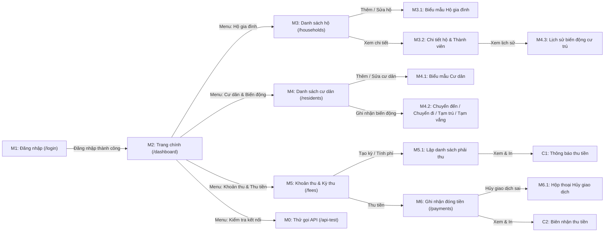

# Thiết kế giao diện và mẫu chứng từ — BlueMoon (Tuần 1)

- **Người thực hiện:** Nguyễn Trần Tuấn Kiệt (MSSV: 202416257)
- **Phạm vi:** Phác thảo màn hình đăng nhập, trang chính, danh sách/biểu mẫu hộ gia đình, cư dân, biến động cư trú, khoản thu, ghi nhận đóng tiền, thông báo thu tiền và biên nhận.
- **Tài liệu căn cứ:** Bộ 16 User Story & Acceptance Criteria (trọng tâm US-02, US-04, US-05, US-06, US-07, US-08, US-09, US-10, US-11, US-12, US-13, US-14, US-15, US-16), NFR-002, NFR-007, [architecture.md](architecture.md), và thiết kế API (`api.md`, `api-households.md`, `api-residents.md`, `api-search.md`).
- **Trạng thái:** Bản thiết kế tuần 1. Các trường liên quan đến hộ–cư dân và thu phí sẽ được đối chiếu lại lần cuối khi hoàn thiện ERD chung (Đỗ Duy Hưng) và thiết kế dữ liệu thu phí (Bùi Văn Thăng).

---

## 1. Nguyên tắc thiết kế giao diện chung (NFR-007 & NFR-002)

1. **Ngôn ngữ:** 100% nhãn trường, nút thao tác, tiêu đề, thông báo thành công và thông báo lỗi sử dụng **tiếng Việt có dấu**, rõ ràng, dễ hiểu.
2. **Thông báo lỗi (NFR-007):** Mọi lỗi nhập liệu phải chỉ rõ **trường sai**, **nguyên nhân** và **cách sửa**. Frontend ánh xạ trực tiếp cấu trúc lỗi JSON từ backend:
   ```json
   {
     "code": "VALIDATION_ERROR",
     "message": "Thông báo tổng quát bằng tiếng Việt.",
     "fieldErrors": {
       "fieldName": "Thông báo lỗi cụ thể cho trường này."
     }
   }
   ```
3. **Trạng thái hiển thị bắt buộc trên mọi màn hình dữ liệu:**
   - **Đang tải (Loading):** Hiển thị trạng thái đang tải khi gọi API.
   - **Rỗng (Empty):** Hiển thị thông báo không có dữ liệu phù hợp, **không giữ lại kết quả của lần tìm trước** (US-15 AC).
   - **Lỗi (Error):** Hiển thị thông báo tiếng Việt thân thiện; với lỗi `401 UNAUTHENTICATED`, tự động chuyển về màn hình Đăng nhập; với lỗi `403 FORBIDDEN`, hiển thị thông báo không có quyền thực hiện.
4. **Phân quyền hiển thị (NFR-002):** Ẩn/khóa menu và nút thao tác không thuộc vai trò (`ADMIN`, `RESIDENT_MANAGER`, `FEE_COLLECTOR`), nhưng mọi kiểm tra quyền chính thức vẫn do backend thực thi.
5. **Tiền tệ và ngày tháng:**
   - Tiền tệ hiển thị theo định dạng Việt Nam: `700.000 đ` (phân tách hàng nghìn bằng dấu chấm, đơn vị `đ` hoặc `VNĐ`).
   - Ngày hiển thị cho người dùng: `DD/MM/YYYY`; gửi/nhận qua API ở định dạng ISO `YYYY-MM-DD`.

---

## 2. Sơ đồ điều hướng màn hình (Screen Transition Diagram)



---

## 3. Phác thảo chi tiết các màn hình

### M1. Màn hình Đăng nhập (`/login`) — US-02

**Bố cục phác thảo:**
```text
+--------------------------------------------------+
|                   BLUEMOON                       |
|        Hệ thống quản lý cư dân và thu phí        |
|                                                  |
|  Tên đăng nhập *                                 |
|  [ nhanvien01                                 ]  |
|                                                  |
|  Mật khẩu *                                      |
|  [ ••••••••••••                         (Hiện)]  |
|                                                  |
|  [!] Tên đăng nhập hoặc mật khẩu không đúng.     |
|                                                  |
|              [    Đăng nhập    ]                 |
|                                                  |
|  * Tài khoản do Quản trị viên nội bộ cấp.        |
+--------------------------------------------------+
```

- **Ghi chú nghiệp vụ:** Không có nút "Đăng ký" (theo US-01: không có đăng ký công khai). Không lưu mật khẩu hoặc mã phiên vào `localStorage` (dùng session cookie `HttpOnly` theo `api.md`).
- **Trường nhập & Nút thao tác:**

| Thành phần | Loại | Bắt buộc | Quy tắc / Hành vi |
|---|---|---|---|
| Tên đăng nhập (`username`) | Text | Có | Không được để trống. |
| Mật khẩu (`password`) | Password | Có | Không được để trống; không tự trim khoảng trắng. |
| Nút `Đăng nhập` | Submit | - | Gọi `POST /api/auth/login` kèm `credentials: 'include'`. Vô hiệu hóa khi đang gửi request. |

- **Thông báo lỗi cơ bản:**
  - Để trống tên đăng nhập: *"Tên đăng nhập không được để trống. Vui lòng nhập tên tài khoản được cấp."*
  - Để trống mật khẩu: *"Mật khẩu không được để trống. Vui lòng nhập mật khẩu."*
  - Sai tài khoản hoặc mật khẩu (`401 INVALID_CREDENTIALS`): *"Tên đăng nhập hoặc mật khẩu không đúng. Vui lòng kiểm tra lại."* (dùng chung một thông báo, không tiết lộ tài khoản có tồn tại hay không).

---

### M2. Trang chính / Tổng quan (`/dashboard`)

**Bố cục phác thảo:**
```text
+---------------+----------------------------------------------------+
|  BLUEMOON     |  Trang chính           [Xin chào: qlcudan01] [Đăng xuất]
+---------------+----------------------------------------------------+
| > Trang chính |  +------------+ +------------+ +------------+      |
|   Hộ gia đình |  | Tổng số hộ | | Tổng cư dân| | Phải thu kỳ|      |
|   Cư dân      |  |    120     | |    415     | | 84.000.000 |      |
|   Khoản thu   |  +------------+ +------------+ +------------+      |
|   Thu tiền    |  +------------+ +------------+                     |
|   Thống kê    |  | Đã thu kỳ  | | Tự nguyện  |                     |
|   Kiểm tra API|  | 62.500.000 | | 12.000.000 |                     |
|               |  +------------+ +------------+                     |
|               |                                                    |
|               |  [Lối tắt nhanh theo vai trò đang đăng nhập]       |
+---------------+----------------------------------------------------+
```

- **Dữ liệu hiển thị:** Tổng số hộ đang ở, tổng số cư dân hiện tại, tóm tắt thu phí kỳ hiện hành (phải thu, đã thu, còn thiếu — tách riêng đóng góp tự nguyện theo US-16).
- **Hiển thị theo quyền:**
  - `RESIDENT_MANAGER`: Ưu tiên lối tắt Hộ gia đình, Cư dân, Biến động cư trú.
  - `FEE_COLLECTOR`: Ưu tiên lối tắt Khoản thu, Ghi nhận đóng tiền, Chứng từ, Thống kê.
  - `ADMIN`: Hiển thị đầy đủ cùng quản lý tài khoản và nhật ký.

---

### M3. Danh sách & Biểu mẫu Hộ gia đình (`/households`) — US-04, US-15

**Bố cục danh sách:**
```text
[Tìm theo mã hộ / tên chủ hộ...] [Lọc mã căn hộ...] [Tìm kiếm]   [+ Thêm hộ gia đình]
+--------+---------+------------------+-------------+----------+-------------------+
| Mã hộ  | Căn hộ  | Chủ hộ           | SĐT liên hệ | Diện tích| Thao tác          |
+--------+---------+------------------+-------------+----------+-------------------+
| HO-001 | A1201   | Nguyễn Văn An    | 0901234567  | 70.0 m²  | [Chi tiết] [Sửa]  |
+--------+---------+------------------+-------------+----------+-------------------+
                                                    < Trước | Trang 1/5 | Sau >
```

- **Trường nhập ở Biểu mẫu Thêm / Cập nhật Hộ gia đình:**

| Trường giao diện | Ánh xạ API (`api-households.md`) | Kiểu | Bắt buộc | Quy tắc kiểm tra |
|---|---|---|---|---|
| Mã hộ | `householdCode` | Text | Có | Duy nhất; không chỉnh sửa khi cập nhật (giữ nguyên mã hộ theo US-04 AC). |
| Mã căn hộ | `apartmentCode` | Text | Có | Không trống. |
| Họ tên chủ hộ | `headOfHouseholdName` | Text | Có | Không trống, hỗ trợ tiếng Việt có dấu. |
| Số điện thoại liên hệ | `contactPhone` | Text | Có | Không trống, đúng định dạng SĐT hợp lệ. |
| Diện tích (m²) | `area` | Number | Có | Số thực dương (`> 0`). Khi sửa diện tích có cảnh báo: *"Thay đổi diện tích chỉ áp dụng cho kỳ thu mới, không ảnh hưởng kỳ đã lập."* |

- **Nút thao tác:** `Tìm kiếm`, `Xóa bộ lọc`, `+ Thêm hộ gia đình`, `Lưu`, `Hủy`, `Chi tiết` (xem danh sách thành viên hiện tại & lịch sử biến động).
- **Thông báo lỗi cơ bản:**
  - Trùng mã hộ (`409`): *"Mã hộ đã tồn tại. Vui lòng nhập mã hộ khác."*
  - Diện tích `<= 0`: *"Diện tích phải lớn hơn 0 m². Vui lòng nhập lại."*
  - Thiếu trường bắt buộc: *"Vui lòng nhập đầy đủ [tên trường]."*
  - Không tìm thấy khi lọc: *"Không tìm thấy hộ gia đình nào phù hợp với điều kiện tìm kiếm."*

---

### M4. Danh sách, Biểu mẫu Cư dân & Biến động cư trú (`/residents`) — US-05, US-06, US-07, US-15

**Bố cục danh sách:**
```text
[Tìm theo mã cư dân / họ tên...] [Lọc theo hộ...] [Tìm kiếm]  [+ Thêm cư dân] [Ghi biến động]
+--------+---------------+--------+------------+--------------+---------------------------+
| Mã CD  | Họ và tên     | Mã hộ  | Quan hệ    | Tình trạng   | Thao tác                  |
+--------+---------------+--------+------------+--------------+---------------------------+
| CD-001 | Nguyễn Văn An | HO-001 | Chủ hộ     | Đang cư trú  | [Lịch sử] [Sửa] [Biến động]|
| CD-002 | Trần Thị Bình | HO-001 | Vợ         | Tạm vắng     | [Lịch sử] [Sửa] [Biến động]|
+--------+---------------+--------+------------+--------------+---------------------------+
```

- **Biểu mẫu Thêm / Cập nhật Cư dân (US-05):**

| Trường giao diện | Ánh xạ API (`api-residents.md`) | Kiểu | Bắt buộc | Quy tắc |
|---|---|---|---|---|
| Mã cư dân | `residentCode` | Text | Có | Duy nhất; không sửa khi cập nhật. |
| Họ và tên | `fullName` | Text | Có | Không trống, tiếng Việt có dấu. |
| Hộ gia đình | `householdId` | Select | Có | Chọn từ danh sách hộ tồn tại. |
| Quan hệ với chủ hộ | `relationshipToHead` | Select | Có | Chủ hộ, Vợ/Chồng, Con, Bố/Mẹ, Khác (chốt danh mục cùng nhóm). |

- **Biểu mẫu Ghi nhận Biến động cư trú (US-06 & US-07):**
  - Tab 1 — **Chuyển đến / Chuyển đi (US-06):**
    - Trường nhập: Cư dân (`residentId`, bắt buộc), Loại biến động (`MOVE_IN` / `MOVE_OUT`, bắt buộc), Hộ gia đình liên quan (`householdId`, bắt buộc), Ngày hiệu lực (`effectiveDate`, bắt buộc), Ghi chú / Địa chỉ trước hoặc nơi chuyển đến (`note`, tùy chọn).
    - Nút: `Lưu biến động`, `Hủy`.
  - Tab 2 — **Tạm trú / Tạm vắng (US-07):**
    - Trường nhập: Cư dân (`residentId`, bắt buộc), Hộ liên quan (`householdId`, bắt buộc), Loại đăng ký (`TEMPORARY_RESIDENCE` / `TEMPORARY_ABSENCE`, bắt buộc), Ngày bắt đầu (`startDate`, bắt buộc), Ngày kết thúc (`endDate`, tùy chọn), Lý do / Địa chỉ tạm trú (`reason`, tùy chọn).
    - Nút: `Lưu đăng ký`, `Hủy`.
- **Thông báo lỗi cơ bản:**
  - Thiếu thông tin US-06: *"Vui lòng chọn đầy đủ cư dân, loại biến động, hộ liên quan và ngày hiệu lực."*
  - Bỏ trống ngày bắt đầu US-07: *"Ngày bắt đầu không được để trống. Vui lòng chọn ngày bắt đầu."*
  - Ngày kết thúc trước ngày bắt đầu US-07: *"Ngày kết thúc không được nhỏ hơn ngày bắt đầu. Vui lòng chọn lại khoảng thời gian hợp lệ."*

---

### M5. Quản lý Khoản thu, Kỳ thu & Tính phí (`/fees`) — US-08, US-09

**Bố cục phác thảo:**
```text
[Lọc kỳ thu: Tháng 11/2026 v] [Loại: Tất cả / Bắt buộc / Tự nguyện]   [+ Tạo khoản thu] [Lập danh sách phải thu]
+------------------+-----------+-----------+------------+------------+------------------+
| Tên khoản thu    | Loại      | Kỳ / Đợt  | Đơn giá    | Hạn đóng   | Thao tác         |
+------------------+-----------+-----------+------------+------------+------------------+
| Phí quản lý      | Bắt buộc  | 11/2026   | 10.000/m²  | 30/11/2026 | [Danh sách phải thu] |
| Quỹ khuyến học   | Tự nguyện | Đợt 2/2026| Tự chọn    | 15/12/2026 | [Ghi nhận đóng góp]  |
+------------------+-----------+-----------+------------+------------+------------------+
```

- **Trường nhập Tạo Khoản thu / Kỳ thu (US-08):** Tên khoản thu (bắt buộc), Loại (`Bắt buộc` / `Tự nguyện`, bắt buộc), Kỳ/Đợt thu (bắt buộc), Đơn giá theo m² (bắt buộc và `> 0` nếu là phí bắt buộc tính theo diện tích), Hạn đóng (bắt buộc).
- **Tính phí & Lập danh sách phải thu (US-09):**
  - Hiển thị bảng xem trước: Mã hộ, Căn hộ, Diện tích (m²), Đơn giá, Thành tiền (`diện tích × đơn giá`, ví dụ `70 m² × 10.000 đ/m² = 700.000 đ`).
  - Nút: `Lập danh sách phải thu`, `Xem & In thông báo thu tiền`.
- **Thông báo lỗi cơ bản:**
  - Đơn giá `<= 0`: *"Đơn giá phí tính theo diện tích phải lớn hơn 0 đồng/m². Vui lòng nhập lại."*
  - Lập trùng khoản phải thu: *"Khoản phải thu cho hộ [Mã hộ] thuộc khoản thu và kỳ này đã tồn tại, hệ thống không tạo trùng."*

---

### M6. Ghi nhận đóng tiền & Hủy giao dịch (`/payments`) — US-10, US-11, US-14

**Bố cục phác thảo:**
```text
Tab: [Thu phí bắt buộc (US-10)]  |  [Đóng góp tự nguyện (US-11)]  |  [Lịch sử giao dịch]

-- Thu phí bắt buộc --
Hộ gia đình: HO-001 (A1201 - Nguyễn Văn An)
Khoản phải đóng: Phí quản lý - Tháng 11/2026
Phải thu: 700.000 đ  |  Đã đóng: 300.000 đ  |  Còn thiếu: 400.000 đ

Số tiền đóng lần này (đ) * : [ 400000          ]
Ngày đóng *                : [ 2026-11-15      ]
Ghi chú                    : [ Nộp đợt 2       ]
                             [ Ghi nhận đóng tiền ]  [ Xem & In biên nhận ]
```

- **Quy tắc hiển thị & kiểm tra:**
  - **Phí bắt buộc (US-10):** Số tiền phải `> 0` và `<= số còn thiếu`. Cho phép đóng nhiều lần.
  - **Đóng góp tự nguyện (US-11):** Chọn hộ, chọn đợt đóng góp, nhập số tiền `> 0`. Không phát sinh công nợ cho hộ không tham gia.
  - **Hủy giao dịch (US-14):** Tại bảng lịch sử giao dịch, chỉ giao dịch đang `Còn hiệu lực` mới hiển thị nút `Hủy giao dịch`. Hộp thoại hủy bắt buộc nhập **Lý do hủy** (`reason`). Giao dịch đã hủy hiển thị badge `Đã hủy` kèm lý do và không thể hủy lại.
- **Thông báo lỗi cơ bản:**
  - Số tiền `<= 0`: *"Số tiền đóng phải lớn hơn 0 đồng. Vui lòng nhập lại."*
  - Số tiền vượt số còn thiếu: *"Số tiền đóng (500.000 đ) vượt quá số còn thiếu (400.000 đ). Vui lòng nhập tối đa 400.000 đ."*
  - Hủy giao dịch thiếu lý do: *"Vui lòng nhập lý do hủy giao dịch trước khi xác nhận."*
  - Hủy lại giao dịch đã hủy: *"Giao dịch này đã bị hủy trước đó và không thể hủy lại."*

---

## 4. Phác thảo mẫu chứng từ (US-12 & US-13)

### C1. Thông báo thu tiền (US-12)

**Mẫu xem trước & in (Khổ A5/A4, hỗ trợ CSS `@media print`):**
```text
+==============================================================+
|  BAN QUẢN TRỊ CHUNG CƯ BLUEMOON                              |
|                     THÔNG BÁO THU TIỀN                       |
|                  Kỳ thu: Tháng 11/2026                       |
+--------------------------------------------------------------+
|  Mã hộ: HO-001               Căn hộ: A1201                   |
|  Chủ hộ: Nguyễn Văn An       Diện tích: 70,0 m²              |
|  Hạn đóng: 30/11/2026                                        |
+--------------------------------------------------------------+
| STT | Khoản thu          | Cách tính          | Số tiền (đ)  |
|-----|--------------------|--------------------|--------------|
|  1  | Phí quản lý 11/2026| 70 m² × 10.000 đ   |      700.000 |
+--------------------------------------------------------------+
|  Tổng phải thu:                                   700.000 đ  |
|  Đã đóng:                                         300.000 đ  |
|  Số tiền còn phải đóng:                           400.000 đ  |
+--------------------------------------------------------------+
|  Ngày lập: 15/11/2026              Người lập thông báo       |
|                                      (Ký, ghi rõ họ tên)     |
+==============================================================+
   [ In thông báo (Ctrl+P) ]   [ Đóng ]
```

- **Quy tắc nghiệp vụ (US-12 AC):**
  - Dữ liệu lấy trực tiếp từ danh sách phải thu đã lập của hộ.
  - Nội dung bản in phải khớp hoàn toàn nội dung xem trước (ẩn thanh menu/nút bấm khi in bằng `@media print`).
  - Không tạo thêm khoản phải thu hay giao dịch khi xem/in thông báo.

### C2. Biên nhận thu tiền (US-13)

**Mẫu xem trước & in:**
```text
+==============================================================+
|  BAN QUẢN TRỊ CHUNG CƯ BLUEMOON                              |
|                     BIÊN NHẬN THU TIỀN                       |
|                  Mã giao dịch: GD-20261115-001               |
+--------------------------------------------------------------+
|  Mã hộ: HO-001               Căn hộ: A1201                   |
|  Chủ hộ: Nguyễn Văn An       Ngày đóng: 15/11/2026           |
|  Khoản thu: Phí quản lý — Kỳ 11/2026 (Phí bắt buộc)          |
+--------------------------------------------------------------+
|  Số tiền đã nộp lần này:                          300.000 đ  |
|  Bằng chữ: Ba trăm nghìn đồng chẵn.                          |
|  Tổng đã đóng cho khoản này:                      300.000 đ  |
|  Số tiền còn thiếu sau lần đóng:                  400.000 đ  |
+--------------------------------------------------------------+
|  Người nộp tiền                     Người thu tiền           |
|  (Ký, ghi rõ họ tên)                (Ký, ghi rõ họ tên)      |
+==============================================================+
   [ In biên nhận (Ctrl+P) ]   [ Đóng ]
```

- **Quy tắc nghiệp vụ (US-13 AC):**
  - Chỉ cho phép lập/in biên nhận từ **giao dịch đã lưu thành công** (nếu giao dịch đã bị hủy, hiển thị rõ dấu `ĐÃ HỦY` hoặc không cho in biên nhận hiệu lực).
  - **In lại biên nhận tuyệt đối không tạo thêm giao dịch mới** (chỉ gọi API `GET`, không gọi `POST`).
  - Trường bắt buộc trên biên nhận: Mã giao dịch, Hộ gia đình (mã hộ, căn hộ, chủ hộ), Khoản thu/Kỳ thu, Số tiền đã đóng, Ngày đóng.

---

## 5. Điểm cần đối chiếu tiếp với nhóm (sau khi có ERD chung)

1. **Với Đỗ Duy Hưng (Hộ–Cư dân & ERD chung):** Khớp danh mục giá trị chuẩn cho `relationshipToHead` (quan hệ với chủ hộ) và xác nhận có bổ sung trường `cccd`, `dateOfBirth`, `gender` ở màn hình Cư dân hay giữ tối thiểu theo `api-residents.md`.
2. **Với Bùi Văn Thăng (Thiết kế thu phí):** Khớp mã trường JSON và quy ước mã giao dịch (`GD-...`), danh sách cột hiển thị trên Thông báo thu tiền & Biên nhận.
3. **Với Nguyễn Quang Huy (API & Luồng MVP):** Thống nhất bộ endpoint thu phí, chứng từ (`US-08..14`, `US-16`) và biến động cư trú (`US-06`, `US-07`).
